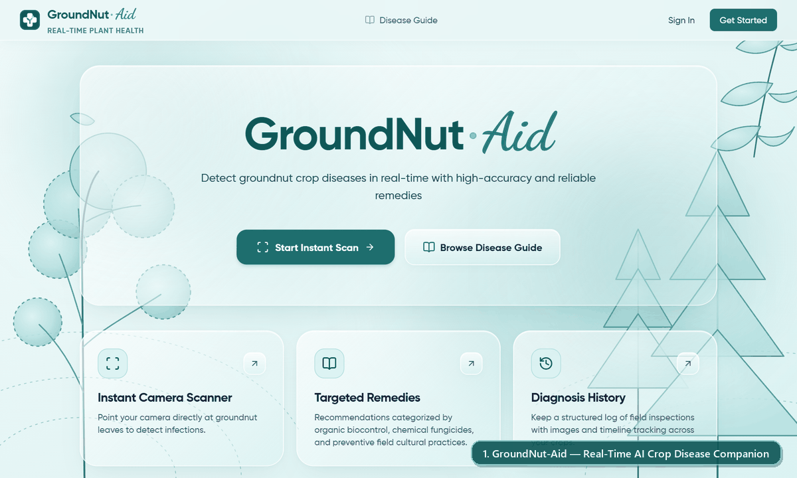

# GroundNut-Aid

**Real-Time AI Plant Disease Identification & Agronomic Treatment Companion**

[](https://plant-aid-seven.vercel.app/)
[](https://rikodon72-plant-aid-api.hf.space)

**GroundNut-Aid** is an AI-powered web application that helps farmers, agronomists, agricultural extension workers, and researchers identify crop diseases in seconds and take immediate, science-backed action. 

Using either your smartphone/laptop camera or a saved photo, GroundNut-Aid pinpoints leaf lesions, diagnoses the condition with calibrated confidence, and provides practical **Organic**, **Chemical**, and **Cultural** treatment plans tailored for the field.

---

## Try It Live

* **Web Application**: **[https://plant-aid-seven.vercel.app/](https://plant-aid-seven.vercel.app/)**
* **AI Inference API**: **[https://rikodon72-plant-aid-api.hf.space](https://rikodon72-plant-aid-api.hf.space)**

> **Tip for Mobile Users:** Open **[plant-aid-seven.vercel.app](https://plant-aid-seven.vercel.app/)** in your phone's browser and grant camera permission on the **Scan** page to use the rear camera directly in the field or garden.

### Demo Preview



---

## What You Can Do with GroundNut-Aid

### 1. Live Camera Scanning & Photo Upload
* **Live Camera Stream**: Point your camera at a plant leaf for continuous real-time analysis (automatically sampling frames every 1.5 seconds without overlapping requests).
* **Photo Upload**: Prefer to snap a photo first? Upload any `JPEG` or `PNG` leaf image from your device for instant analysis.

### 2. Visual Lesion Pinpointing & Heatmaps
* **Color-Coded Bounding Boxes**: GroundNut-Aid visually frames the detected leaf on screen using clear status colors:
  * **Emerald**: Healthy foliage detected
  * **Crimson**: Confirmed disease lesion detected
  * **Amber**: Low confidence or ambiguous frame—reposition the camera for a clearer view
* **Lesion Saliency Heatmap**: Toggle the thermal overlay on your diagnosis result to see the exact spots and discoloration patterns that triggered the AI's diagnosis.

### 3. Honest Confidence Calibration (No False Alarms)
* Generic plant apps often guess a random disease even when pointed at soil, a desk, or a blurry leaf.
* GroundNut-Aid first verifies that plant foliage is actually in frame, and then applies a **55% confidence threshold ($\tau = 0.55$)**—explicitly warning you when a scan is uncertain so you never apply unnecessary treatments based on a weak guess.

### 4. Actionable 3-Way Treatment Plans
Every diagnosed condition comes with a structured treatment guide broken down into three practical approaches:
1. **Organic / Biological**: Eco-friendly botanical extracts (like Neem Seed Kernel Extract) and bio-control agents (*Trichoderma*, *Bacillus subtilis*).
2. **Chemical / Fungicide**: Targeted systemic and contact fungicides or foliar micronutrients with exact mixing ratios (g/L or ml/L) and spray intervals.
3. **Preventive Cultural Practices**: Long-term field hygiene, crop rotation, spacing, and irrigation adjustments to stop outbreaks from returning.

### 5. Personal Diagnosis History & CSV Export
* **Intentional Logging**: Live camera frames never clutter your history automatically—you choose which diagnoses to save with a single click on **Save Diagnosis to History**.
* **Filter & Review**: Search your saved logs by disease type or date range, inspect past leaf captures, and reopen treatment instructions anytime.
* **Export Farm Reports**: Download your diagnostic history as a **CSV spreadsheet** directly from your Profile page for farm record-keeping or research.

### 6. Interactive Disease Guide
* Browse the built-in **Disease Guide** anytime—even without scanning a leaf—to study symptoms, scientific names, severity ratings, and full remedy protocols across all cataloged diseases.

### 7. Secure 2FA Accounts & Admin Governance
* **Two-Factor Authentication (2FA)**: Accounts are protected with bcrypt password encryption and a 6-digit email One-Time Passcode (OTP) on sign-in, plus self-service password recovery.
* **Admin Console (`/admin`)**: Platform administrators get a dedicated governance console to search registered users, promote/demote admin roles, suspend or reactivate accounts, oversee platform-wide scan activity, and add or edit treatment remedies live.

---

## How to Use the App (Step-by-Step)

1. **Create an Account & Sign In**
   Visit **[plant-aid-seven.vercel.app](https://plant-aid-seven.vercel.app/)**, click **Get Started**, and register with your name and email. Enter the 6-digit verification code sent to your inbox to activate your account and sign in.

2. **Scan a Leaf**
   Navigate to **Scan** from the top menu (or tap the floating scan button):
   * Select **Live Camera** to stream from your device camera and hold a leaf steady inside the viewfinder.
   * Or select **Upload Photo** to pick an existing picture of a leaf from your phone or computer.

3. **Inspect the Diagnosis**
   Within seconds, the diagnostic panel displays:
   * The identified **Disease Name** and **Scientific Name**
   * The **Confidence Score** and **Severity Badge** (`NONE`, `MEDIUM`, `HIGH`, or `SEVERE`)
   * A toggle to switch between the **Original Capture** and the **AI Saliency Heatmap**

4. **Check the Treatment Plan**
   Click **View Treatment Plan** to open the interactive modal. Switch between the **Organic**, **Chemical**, and **Cultural** tabs to read the recommended remedies and step-by-step application instructions.

5. **Save & Track Your Outbreaks**
   Click **Save Diagnosis to History** to store the result in your personal logbook. Visit **Dashboard** for a quick overview of your recent scans, or **History** to filter, review, or delete past records.

---

## Supported Crop Diseases

GroundNut-Aid's primary deep vision model is trained and calibrated on **6 Groundnut (*Arachis hypogaea*) foliage conditions**:

| Condition | Scientific / Causal Agent | Type | Severity | Key Visual Symptoms |
|---|---|---|---|---|
| **Groundnut Early Leaf Spot** | *Cercospora arachidicola* | Fungal | `HIGH` | Circular reddish-brown spots surrounded by bright yellow halos |
| **Groundnut Early Rust** | *Puccinia arachidis Speg.* | Fungal | `MEDIUM` | Small, scattered dark-brown pustules emerging on lower leaves |
| **Healthy Leaf** | *Arachis hypogaea L.* | Healthy | `NONE` | Uniform green foliage with no lesions or chlorosis |
| **Groundnut Late Leaf Spot** | *Phaeoisariopsis personata* | Fungal | `SEVERE` | Dark brown-to-black spots on the underside of leaves without yellow rings |
| **Nutrition Deficiency** | *Fe / Zn / N Chlorosis* | Abiotic | `MEDIUM` | Interveinal yellowing on young leaves or pale, stunted foliage |
| **Groundnut Rust** | *Puccinia arachidis Speg.* | Fungal | `HIGH` | Dense orange-brown blister-like pustules across the leaf surface |

*(The built-in **Disease Guide** also includes reference treatment catalogs for **Tomato Late Blight**, **Potato Early Blight**, **Apple Scab**, and **Grape Black Rot**.)*

---

## How It Works Under the Hood

GroundNut-Aid is designed to deliver fast, explainable diagnoses without requiring expensive GPU hardware in the field:

1. **Stage 1 — Foliage Isolation (OpenCV HSV Masking)**:
   When an image arrives, the vision pipeline converts it into the HSV color space to isolate green/chlorotic plant tissue from background soil, twigs, or hands. If no plant foliage is present, it immediately lets the user know rather than forcing a false classification.
2. **Stage 2 — Deep Vision Classification & Saliency (ConvNeXt-Tiny)**:
   The isolated leaf region is passed into a fine-tuned **PyTorch ConvNeXt-Tiny** neural network that predicts probabilities across the 6 Groundnut classes. Simultaneously, an HSV hue-distance saliency map highlights necrotic and chlorotic lesion areas inside the leaf boundary so users can visually verify what the model detected.
3. **Stage 3 — Confidence Calibration ($\tau = 0.55$)**:
   Predictions are gated against a calibrated threshold of **55%**. Any scan falling below $\tau = 0.55$ is marked as uncertain, prompting the user to capture a clearer angle under better lighting.
4. **Full-Stack Cloud Architecture**:
   * **Frontend**: Built with **React 19**, **TypeScript**, **Vite**, **Tailwind CSS**, and **Motion**, deployed globally on **Vercel**.
   * **Backend & AI Engine**: Built with **FastAPI**, **PyTorch**, and **OpenCV**, containerized and hosted on **Hugging Face Spaces**.
   * **Database & Storage**: Powered by **Neon Serverless PostgreSQL** (with SQLite support for local offline development) and **SQLAlchemy / Alembic**, with S3-compatible and local media storage.

---

## Running GroundNut-Aid Locally (Optional)

If you want to run your own copy of GroundNut-Aid on your machine:

### Option A: One-Command Docker Launch
```bash
cp .env.example .env
docker compose up --build
```
* **Web App**: `http://localhost`
* **Backend API & Docs**: `http://localhost:8000/docs`

### Option B: Manual Local Development
**1. Start the Backend (`http://localhost:8000`):**
```bash
cd backend
uv venv && uv pip install -r requirements.txt
uv run alembic upgrade head
uv run python seed.py
uv run uvicorn app.main:app --reload --port 8000
```

**2. Start the Frontend (`http://localhost:5173`):**
```bash
cd frontend
npm install
npm run dev
```

---

## License

This project is licensed under the MIT License.
